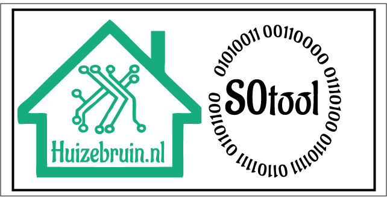
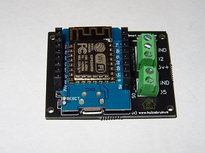
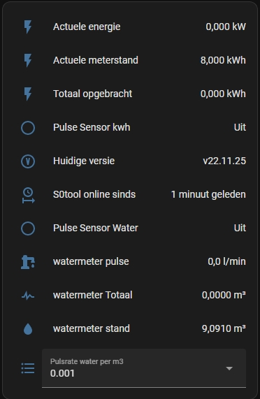

<div align="center">

# S0tool



**Turn your water and energy meters into smart meters with ESPHome and Home Assistant**

[](https://github.com/huizebruin/s0tool/releases)
[](https://github.com/huizebruin/s0tool/commits/main)
[](LICENSE)
[](https://github.com/huizebruin/s0tool/stargazers)
[](https://github.com/huizebruin/s0tool/network/members)
[](https://discord.gg/AskpfnY)
[](https://esphome.io)

[Website](https://s0tool.nl) • [Installation](https://s0tool.nl/installation.html) • [FAQ](https://s0tool.nl/faq.html) • [Shop](https://www.huizebruin.nl/shop) • [Discord](https://discord.gg/AskpfnY)

</div>

---

## Overview

The **S0tool** is an ESPHome-based device (Wemos D1 Mini, ESP8266) that reads pulses from water meters and from kWh meters with an S0 output, and shows the readings in Home Assistant, including the Energy dashboard.

| S0tool device | Home Assistant dashboard |
|:---:|:---:|
|  |  |

## Features

- 💧 **Water meter** monitoring with an NPN inductive sensor (or Cyble sensor)
- ⚡ **kWh / S0 pulse** monitoring: solar, heat pump, or any meter with an S0 output
- 🏠 **Home Assistant** auto-discovery and Energy dashboard support
- 🌐 **Web installer**: flash from your browser, no tools needed
- 🔄 **Firmware updates** straight from Home Assistant (Settings → Updates)
- 🎯 Water and kWh at the same time, plus several ready-made configurations for specific meters

## Quick start

| Requirement | Version |
|:---|:---|
| Home Assistant | 2026.2.0 or newer |
| ESPHome (when building yourself) | 2026.8.0 or newer |
| Wi-Fi | 2.4 GHz (802.11 b/g/n) |
| Power | USB 5 V, 1 A |

1. Get an S0tool: [buy it ready-made](https://www.huizebruin.nl/shop) or [build your own](https://s0tool.nl/diyorbuy.html).
2. Connect it via USB and flash it with the [web installer](https://s0tool.nl/installation.html) (Chrome, Edge or Opera). No serial port? See the [USB driver help](https://s0tool.nl/troubleshooting.html#drivers).
3. Join your Wi-Fi. The device shows up in Home Assistant under **Settings → Devices & services → ESPHome**.

## Documentation

Everything else lives on **[s0tool.nl](https://s0tool.nl)**, so there is one place to keep up to date:

| Topic | Page |
|:---|:---|
| Flashing and the available configurations | [Installation](https://s0tool.nl/installation.html) |
| Parts list, wiring diagrams, kWh meter connection | [DIY or buy](https://s0tool.nl/diyorbuy.html) |
| Energy dashboard, changing meter readings, USB drivers | [Troubleshooting](https://s0tool.nl/troubleshooting.html) |
| Common questions | [FAQ](https://s0tool.nl/faq.html) |
| Confirmed compatible water and kWh meters, reviews, Discord | [Community](https://s0tool.nl/community.html) |
| What changed per version | [Release notes](https://s0tool.nl/releases.html) |

### Home Assistant examples

This repository contains example files for Home Assistant: template sensors in [`packages/`](packages), a firmware-update card in [`lovelace.yaml`](lovelace.yaml), and utility meters for consumption per quarter, hour, day, week and month:

```yaml
# configuration.yaml
utility_meter: !include utility_meter/utility.yaml
```

Copy [`utility_meter/utility.yaml`](utility_meter/utility.yaml) to `config/utility_meter/utility.yaml` first. It reads `sensor.watermeter_totaal`.

Dutch documentation: [huizebruin.nl](https://www.huizebruin.nl/home-assistant/wat-is-de-s0tool/).

## Updates

New firmware shows up in Home Assistant as a normal update (**Settings → System → Updates**, entity *Firmware* on the S0tool device). Press **Install** to update over Wi-Fi. The device checks every 6 hours; the *Check for firmware update* button checks immediately.

Prefer the ESPHome dashboard? Open your S0tool, choose **⋮ → Validate → Install**.

If you build your own firmware, add this line to the `packages` of your configuration to get the same update entity:

```yaml
- esphome/components/update.yaml
```

## ⚠️ Safety

The S0tool itself runs on 5 V USB power, but the meters it reads (especially 32–45 A kWh meters) sit in your fuse box. Do not work on live mains wiring. Have the meter installed or replaced by a qualified electrician, and only connect the S0tool to the meter's low-voltage S0 output.

## Contributing

Contributions are welcome: bug reports, meter compatibility reports, documentation and pull requests. Read [CONTRIBUTING.md](CONTRIBUTING.md) first, and check the [Code of Conduct](CODE_OF_CONDUCT.md) and [Security policy](SECURITY.md).

- 🐛 [Report an issue](https://github.com/huizebruin/s0tool/issues)
- 💬 [Discussions](https://github.com/huizebruin/s0tool/discussions) (meter compatibility lists: [water #57](https://github.com/huizebruin/s0tool/discussions/57), [power #250](https://github.com/huizebruin/s0tool/discussions/250))
- 💬 [Discord](https://discord.gg/AskpfnY)

## Support the project

S0tool is a hobby project. If it is useful to you, you can support it with [PayPal](https://paypal.me/huizebruin) or [Ko-fi](https://ko-fi.com/W7W4QU9ZX), or just give the repository a ⭐.

Some links on s0tool.nl and huizebruin.nl are affiliate links; they help pay for the project at no extra cost to you.

## License

[MIT](LICENSE) © 2021–2026 Huizebruin.nl / S0tool.nl

## Credits

Created by Wobbe, [Huizebruin.nl](https://www.huizebruin.nl) & [S0tool.nl](https://s0tool.nl). Powered by [ESPHome](https://esphome.io) and [ESP Web Tools](https://esphome.github.io/esp-web-tools/).

<div align="center">

Made with ❤️ for the Home Assistant community

</div>
